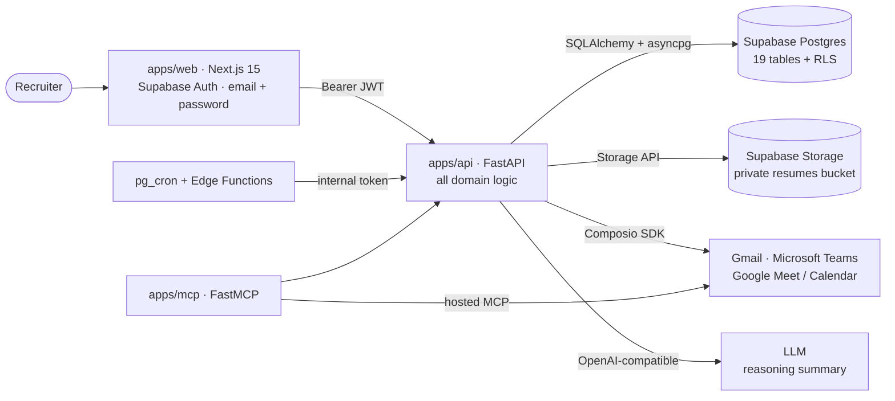

<div align="center">

# AI Recruiter OS

**A production-only, end-to-end AI recruiting workspace — from Gmail inbox to ranked shortlist to a booked Microsoft Teams / Google Meet interview, with every external side effect gated behind human approval.**

[](https://www.python.org/)
[](https://fastapi.tiangolo.com/)
[](https://nextjs.org/)
[](https://www.typescriptlang.org/)
[](https://supabase.com/)
[](https://langchain-ai.github.io/langgraph/)
[](apps/mcp/README.md)
[](#testing)

</div>

---

## Table of contents

- [Why this stands out](#why-this-stands-out)
- [At a glance](#at-a-glance)
- [What it does](#what-it-does)
- [Architecture](#architecture)
- [Feature deep dives](#feature-deep-dives)
- [Tech stack](#tech-stack)
- [Repository layout](#repository-layout)
- [Getting started](#getting-started)
- [Configuration](#configuration)
- [API surface](#api-surface)
- [Testing](#testing)
- [Engineering quality](#engineering-quality)
- [Honest limitations & status](#honest-limitations--status)
- [Documentation](#documentation)

---

## Why this stands out

Most "AI recruiter" demos stop at a chatbot that *talks about* hiring. This is a
complete, tenancy-aware system that **actually moves candidates through a
pipeline** — and is deliberately honest about the boundaries of what it can do.

| | |
| --- | --- |
| **Real integrations, never simulated** | Gmail ingestion, Microsoft Teams meetings, Google Meet rooms and Google Calendar events are created through the official Composio SDK. If a provider is not connected, the UI says so and the action *fails honestly* — no fake "success", ever. |
| **Approval gate as a single choke point** | Emails, meeting creation and cancellations are written to `pending_actions` and **nothing leaves the system until a recruiter approves it**. Every action is also logged to `recruiter_activity_logs`. |
| **Deterministic, explainable scoring** | Candidates are scored on transparent weighted components (skills `.38`, experience `.20`, projects `.22`, location `.08`, evidence `.12`) with a written explanation, named strengths and gaps. The arithmetic is reproducible; the LLM only enriches the narrative. |
| **Evidence, not vibes** | GitHub repos/languages/activity and LeetCode profiles are fetched and cited as evidence with source links. A claim without evidence is never invented. |
| **A real security model** | Supabase JWT verification (HS256 **and** ES256/RS256 via JWKS), per-workspace filtering on every query, Postgres row-level security, and service-role credentials that never reach the browser. |
| **Idempotent, resumable ingestion** | Queue + retry with exponential backoff, unique constraints on provider message/attachment ids, and a recovery endpoint that reclaims rows from crashed workers. |
| **One service layer, two front doors** | The FastAPI app and the FastMCP server share the *same* service functions, so an LLM calling MCP tools gets typed, DB-executed answers instead of hallucinated ones. |

## At a glance

| Metric | Value |
| --- | --- |
| Tracked source files | 103 |
| Python modules | 45 |
| TypeScript / TSX files | 31 |
| REST endpoints | 43 |
| Postgres tables | 19 |
| SQL migrations | 5 |
| Supabase Edge Functions | 2 |
| Tests | **61 passing**, 19 DB-gated (skipped without a scratch DB) |
| Modes | Production only — no demo, no SQLite, no local identity |

## What it does

| Capability | How it works |
| --- | --- |
| **Resume ingestion** | Gmail is polled on a schedule. Resume attachments (PDF/DOCX/TXT) are downloaded, stored in a private Supabase Storage bucket, and parsed into structured candidate rows. |
| **Explainable evaluation** | A job description is turned into structured requirements, candidates are retrieved from the database, then scored with a written explanation plus named strengths and gaps. |
| **Verification** | GitHub and LeetCode profiles are fetched and cited as evidence — never invented. |
| **Recruiter assistant** | Natural-language search, compare, draft and schedule over the live workspace, with a streaming "Thinking" panel that surfaces the model's reasoning summary. Tool side effects are queued as pending actions. |
| **Interview scheduling** | A real Microsoft Teams meeting or Google Meet room (plus its Google Calendar event) is created; the real join URL is emailed through Gmail. The platform is chosen **per meeting** — there is no silent default. |
| **Company profile** | The recruiter saves company name, company phone and interviewer **once** (first login or Settings); every email and invitation signs with them automatically. The assistant writes a `[Phone]` placeholder and the server fills it from the saved profile. |
| **Approvals & audit** | External side effects flow through `pending_actions`; changes are recorded in `recruiter_activity_logs` and `candidate_status_history`. |
| **Composio tool layer** | Official Composio SDK with per-workspace scoped sessions, plus a hosted MCP bridge so the assistant can call Gmail/Teams tools. |

## Architecture



- **`apps/web`** never talks to the database directly with elevated rights — it
  reads through the API with the recruiter's Supabase JWT.
- **`apps/api`** owns all domain logic and holds the only service-role
  connection.
- **`apps/mcp`** re-uses the same service layer, exposing it as typed MCP tools.
- **`supabase`** holds migrations (schema, RLS, pg_cron) and two thin Edge
  Functions that relay to the API's internal endpoints.

## Feature deep dives

### 1 · Resume ingestion

```
scheduler (in-process by default, or pg_cron → Edge Function)
  └─▶ POST /internal/cron/tick   (token-authenticated)
        └─▶ enqueue ingestion_jobs → process job
              └─▶ GMAIL_FETCH_EMAILS → GMAIL_GET_ATTACHMENT
                    └─▶ store in private bucket → parse résumé
                          └─▶ upsert candidate → record application
                                └─▶ schedule next_sync_at (progress or backoff)
```

Idempotency is enforced by unique constraints on the provider message and
attachment ids; failures increment `attempts` and back off, and a crashed
worker's rows are reclaimed by `/internal/recover`.

### 2 · Explainable evaluation

```
POST /api/jobs/{id}/evaluate
  retrieve candidate pool → (optional) GitHub / LeetCode verification
  → weighted component scores → written explanation + strengths + gaps
  → upsert candidate_evaluations (unique per candidate + job)
```

### 3 · Interview scheduling

```
POST /api/interviews/schedule  → pending action (approval gate)
POST /api/actions/{id}/approve
  Microsoft Teams → CREATE_OR_GET_ONLINE_MEETING   (fallback: CREATE_MEETING)
  Google Meet     → GOOGLECALENDAR_CREATE_EVENT     (fallback: GOOGLEMEET_CREATE_MEET)
  → persist the real join URL + calendar event id
  → queue a Gmail confirmation + send action
```

A missing join URL is an **error** — no room is ever synthesised. Conflict
detection only considers interviews this workspace created; external calendar
availability is never assumed.

### 4 · Recruiter assistant

`POST /api/chat/stream` (SSE) runs the assistant workflow: classify intent → run
the matching tool (search / compare / draft / schedule / approvals) → stream the
reply with a collapsible **Thinking** disclosure built from the provider's
reasoning summary. Any side-effecting tool writes a pending action instead of
acting directly.

### 5 · Approval gate & audit

`pending_actions` is the single choke point for emails, meeting creation and
cancellation. Approvals, rejections and status changes are appended to the audit
tables, so the UI can always show what happened — and never implies delivery
that did not occur.

## Tech stack

| Layer | Technology |
| --- | --- |
| API | FastAPI · Uvicorn · SQLAlchemy 2 (async) · asyncpg · Pydantic v2 |
| Agent workflows | LangGraph · LangChain · OpenAI-compatible LLM (reasoning summaries) |
| Integrations | Composio SDK · FastMCP · Gmail · Microsoft Teams · Google Meet / Calendar |
| Database | Supabase Postgres — 19 tables, RLS, pg_cron, pg_net, Vault |
| Storage | Supabase Storage (private `resumes` bucket) |
| Frontend | Next.js 15 (App Router) · React 19 · TypeScript 5 · Tailwind CSS v4 · Supabase Auth |
| Testing | pytest · pytest-asyncio · provider fakes (no external calls) |

## Repository layout

```
apps/api        FastAPI service — all domain logic, REST API, agent graphs, cron tick
apps/web        Next.js 15 dashboard (App Router, Tailwind v4, Supabase Auth)
apps/mcp        FastMCP server — the same service layer exposed as MCP tools
supabase        SQL migrations (schema, RLS, pg_cron) + Edge Functions
docs            Setup, architecture, deployment and Composio notes
```

## Getting started

### Prerequisites

- Python 3.11–3.13 (3.12 recommended — very new releases may lack wheels)
- Node.js 18.18+ (20+ recommended)
- A Supabase project (Postgres, Auth, Storage)
- Optional: a Composio project (Gmail, Microsoft Teams, Google Calendar/Meet), an
  OpenAI-compatible LLM endpoint, a GitHub token

### 1 · Supabase

Apply, in order, in the SQL editor (or `supabase db push`):

```
supabase/migrations/0001_schema.sql
supabase/migrations/0002_rls.sql
supabase/migrations/0003_cron.sql        (optional — scheduled ingestion)
supabase/migrations/0004_job_application_subject.sql
supabase/migrations/0005_perf_indexes.sql
```

Create a user under **Authentication → Users** with an email and password. The
web app signs in with email + password; magic links are not used.

### 2 · Database credentials

`DATABASE_URL` must use the asyncpg driver:

```
postgresql+asyncpg://postgres.<project-ref>:<url-encoded-password>@aws-0-<region>.pooler.supabase.com:5432/postgres
```

Use the session pooler (port `5432`) or a direct connection. On the transaction
pooler (port `6543`), append `?prepared_statement_cache_size=0`.

### 3 · Run the API

```bash
cd apps/api
python -m venv .venv
.venv/Scripts/pip install -r requirements.txt           # Windows
# source .venv/bin/activate && pip install -r requirements.txt   # macOS/Linux
.venv/Scripts/python -m uvicorn app.main:app --host 127.0.0.1 --port 8000
```

The API validates every required setting at boot and **refuses to start** if
`DATABASE_URL`, `SUPABASE_URL`, `SUPABASE_SERVICE_ROLE_KEY`,
`SUPABASE_JWT_SECRET`, `API_INTERNAL_TOKEN` or `WEB_ORIGIN` is missing.

### 4 · Run the web app (separate terminal)

```bash
cd apps/web
npm install
npm run dev                                             # http://localhost:3000
npm run build && npm run start                          # production-like
```

Sign in with your Supabase user. The first authenticated request creates the
workspace automatically. Connect Gmail and Microsoft Teams under **Settings →
Integrations**, and set your company profile under **Settings → Company**.

### 5 · Optional — MCP server

```bash
cd apps/mcp
python -m venv .venv && .venv/Scripts/pip install -r requirements.txt
python server.py            # stdio (Claude Desktop / Cursor)
python server.py --http     # streamable HTTP on :8765/mcp
```

See [`apps/mcp/README.md`](apps/mcp/README.md) for the full tool list and
Claude Desktop config.

## Configuration

All configuration is environment driven:

- API: [`.env.example`](.env.example)
- Web: [`apps/web/.env.local.example`](apps/web/.env.local.example)

Groups: runtime, database, Supabase, LLM (optional), Composio (Gmail +
Teams/Google Meet), GitHub (optional) and MCP. With no LLM key the product still
works end-to-end using rule-based extraction and templated scoring/emails.

## API surface

Representative endpoints (all workspace-scoped under `/api`):

| Group | Endpoints |
| --- | --- |
| Core | `GET /me` · `PUT /workspace/profile` · `GET /team` · `GET /activity` |
| Connections | `GET /connectors` · `POST /connectors/connect` · `POST /connectors/{id}/verify` · `DELETE /connectors/{id}` |
| Sync | `GET/PUT /sync/settings` · `POST /sync/now` · `GET /sync/jobs` |
| Candidates | `GET /candidates` · `POST /candidates/search` · `GET /candidates/{id}` · `PATCH /candidates/{id}/status` · resume & attachments |
| Jobs | `GET/POST /jobs` · `GET/PATCH /jobs/{id}` · `POST /jobs/{id}/evaluate` · `GET /jobs/{id}/evaluations` |
| Interviews | `GET /interviews` · `POST /interviews/availability` · `POST /interviews/schedule` · `POST /interviews/{id}/cancel` · `POST /interviews/{id}/reschedule` |
| Communications | `GET /communications` · `POST /communications/draft` · `POST /communications/{id}/send` |
| Approvals | `GET /actions` · `POST /actions/{id}/approve` · `POST /actions/{id}/reject` |
| Assistant | `POST /chat` · `POST /chat/stream` (SSE) · `GET /chat/threads` · `GET/DELETE /chat/{thread_id}` |
| Internal | `POST /internal/cron/tick` · `POST /internal/recover` (token-authenticated) |

## Testing

```bash
cd apps/api
TEST_DATABASE_URL=postgresql+asyncpg://... \
.venv/Scripts/python -m pytest -q
```

- `61 passing`: pure unit tests for scoring, parsing, policies, placeholder
  resolution, prompt construction and provider resolution.
- `19 DB-gated` tests skip cleanly when `TEST_DATABASE_URL` is not set.
- Gmail, Teams and Storage are replaced with fakes, so the suite **never calls
  external providers**.

> ⚠️ The suite drops and recreates every table in the target database — never
> point `TEST_DATABASE_URL` at your application database.

## Engineering quality

- **Fail fast & loud.** Missing configuration is a boot error; a missing
  integration raises `IntegrationError` instead of pretending to succeed.
- **Defense in depth.** Per-workspace query scoping + Postgres RLS + JWT
  verification (HS256 and JWKS-backed ES256/RS256) + constant-time internal-token
  comparison.
- **Untrusted input is fenced.** Resume and email text is fenced before reaching
  the LLM (`app/llm.py`).
- **Idempotency everywhere it matters.** Unique constraints and idempotency keys
  guard ingestion and scheduling against duplicate work.
- **Deterministic by default.** No LLM key? The product still runs end-to-end
  with rule-based extraction and templated emails.
- **Tests that mean something.** Behavior is locked in with fast, provider-free
  unit tests; DB paths are exercised when a scratch database is available.

## Honest limitations & status

- Live OAuth and real Gmail/Teams calls are **unverified without Composio
  credentials**. The code paths are implemented and unit-tested with fakes; the
  hosted end-to-end calls have not been exercised in this environment.
- Microsoft Teams auth currently fails at the **Composio provider level** (the
  connected account is active but unusable); Google Meet/Calendar is unaffected.
- Supabase cron stays inert until the Vault secrets and Edge Function secrets
  are set (see [`docs/DEPLOYMENT.md`](docs/DEPLOYMENT.md)); it logs a notice
  instead of faking a run. An in-process scheduler covers sync meanwhile.
- JWT verification supports both signing schemes: legacy HS256 with
  `SUPABASE_JWT_SECRET`, and ES256/RS256 against the project's JWKS (the default
  for new Supabase projects).

## Documentation

| Document | Contents |
| --- | --- |
| [`docs/SETUP.md`](docs/SETUP.md) | Full setup, every credential |
| [`docs/ARCHITECTURE.md`](docs/ARCHITECTURE.md) | Components, data model, key flows, security |
| [`docs/DEPLOYMENT.md`](docs/DEPLOYMENT.md) | Deploying the API, web app and cron |
| [`docs/COMPOSIO.md`](docs/COMPOSIO.md) | Exact tool slugs and the adapter contract |
| [`apps/mcp/README.md`](apps/mcp/README.md) | MCP tools and client configuration |

---

<div align="center">

**Built to be trusted in production: real integrations, real approvals, real
audit — and honest about everything else.**

</div>
